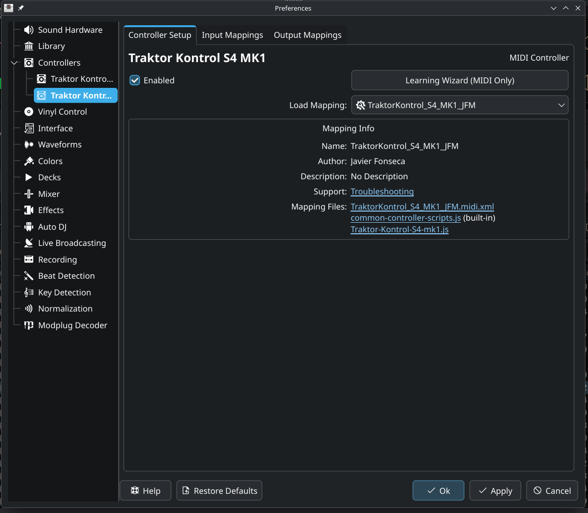
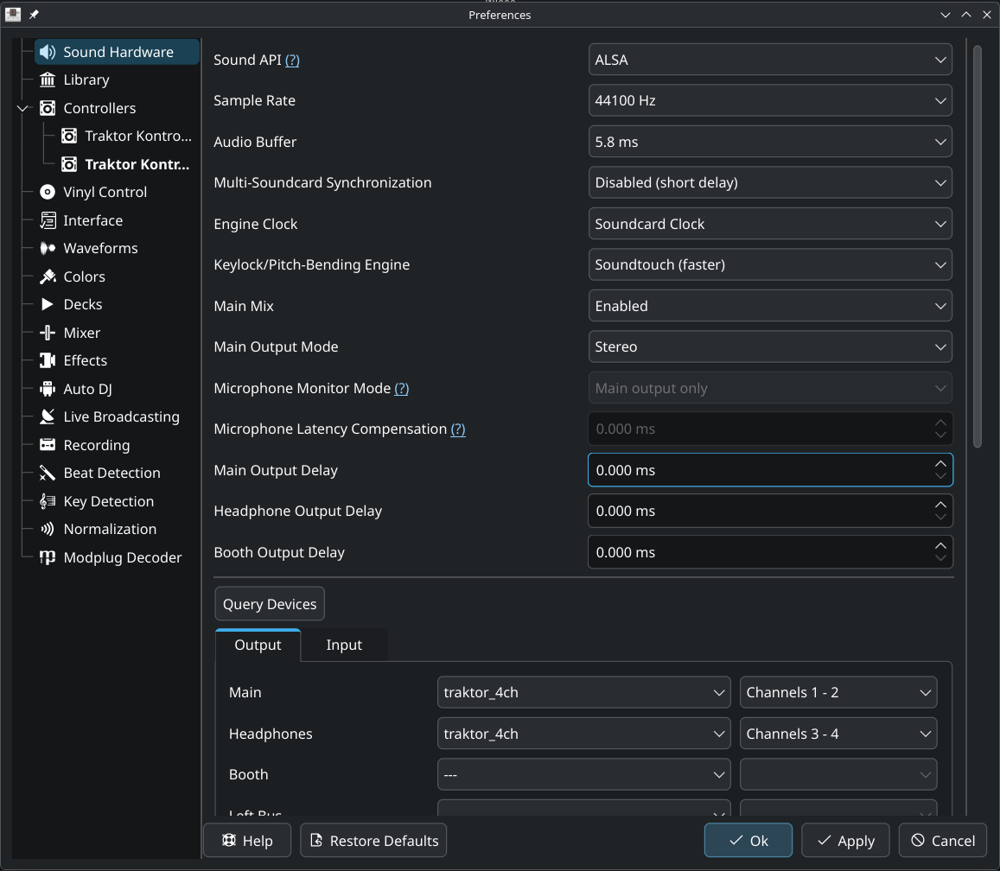

Breathing new life into an old controller. Traktor S4 Mk1, no more macos support. Want to use linux.


<!--more-->

# Driver

First, needed to see if it actually worked, so found this thread about getting it set up

Made a fork with the following improvements:
- 

https://github.com/justinmklam/traktor-kontrol-s4-mk1-driver-linux

Need to convert the USB to MIDI so that Mixxx can pick it up in the mapping.

# Mixxx

Select the custom driver one



Create wireplumber to tell pipewire to ignore traktor and stop fighting legacy `snd_usb_caiaq`:
```sh
mkdir -p ~/.config/wireplumber/wireplumber.conf.d/
nano ~/.config/wireplumber/wireplumber.conf.d/51-ignore-traktor.conf
```
Then in the file:
```toml
monitor.alsa.rules = [
  {
    matches = [
      {
        device.name = "~alsa_card.usb-Native_Instruments_Traktor_Kontrol_S4*"
      }
    ]
    actions = {
      update-props = {
        device.disabled = true
      }
    }
  }
]
```

In `~/.asoundrc`:
```
pcm.traktor_4ch {
    type multi
    slaves {
        a { pcm "hw:TraktorKontrolS,0,0" channels 2 }
        b { pcm "hw:TraktorKontrolS,0,1" channels 2 }
    }
    bindings {
        0 { slave a channel 0 }
        1 { slave a channel 1 }
        2 { slave b channel 0 }
        3 { slave b channel 1 }
    }
}

ctl.traktor_4ch {
    type hw
    card "TraktorKontrolS"
}

```

Then in mixxx, choose `traktor_4ch` and change:
- sample rate: 441000 Hz
- Audio buffer: 5.8ms
- Multi sound card sync: disabled



If audio cuts out, check if usb suspend is active:
```
cat /sys/module/usbcore/parameters/autosuspend
```

If it's not 0 or -1, then it's enabled so disable it for the current session:
```
echo -1 | sudo tee /sys/module/usbcore/parameters/autosuspend
```

# Hardware Refresh


Heating it up to remove the faceplates


Faceplates reomved


Backside opened up


Janky resistor


Was already repaired previously, but with different sized buttons


Easiest way was to snip the legs


Putting it back together, nice to see icons showing which holes should be screwed


All done!
